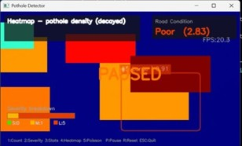

# AI Road Damage Detection

A computer vision project for detecting road damage in video using YOLOv8 and Python.

## Features

- Road damage detection using a trained YOLO model.
- Video processing with OpenCV.
- Object tracking and severity analysis implemented in the detection pipeline.
- Visual statistics and analysis, depending on the implemented application features.

## Technologies Used

- Python
- Ultralytics YOLO
- OpenCV
- NumPy
- Matplotlib

## Project Structure

```text
AI-Road-Damage-Detection/
├── video_detection.py
├── requirements.txt
├── models/
│   └── best.pt
├── dataset/
└── road.mp4
```

## Setup

1. Install a compatible Python version.
2. Clone this repository.
3. Create and activate a virtual environment.
4. Install the dependencies:

```bash
pip install -r requirements.txt
```

## Run

```bash
python video_detection.py
```

Ensure that `models/best.pt` exists and that the input video is available at the path expected by the script.

## Limitations

Severity estimates based on bounding-box area are approximate and do not directly measure the physical depth or dimensions of road damage.

## Project Screenshots

### Road Damage Detection


### Pothole Density Heatmap


### Statistical Analysis


### Damage Severity Classification


### Pothole Counting and Tracking

